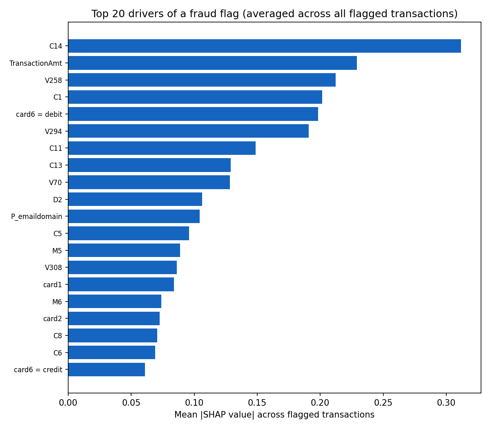

# Explaining flagged transactions with SHAP

At Stage 4's recommended threshold (0.45), **19,057** of the 147,635 test transactions are flagged. SHAP was computed for every one of them (not just the examples below); the full per-transaction reasons are saved to `data/processed/shap_top_reasons_flagged.parquet` for Stage 6 to use.

**How to read a SHAP number:** each one is signed - positive pushed the score toward fraud, negative pushed it toward not-fraud - and the SIZE shows how much that one feature mattered for that one transaction, relative to the model's other features. They're in the model's internal scoring units, not literal probability percentage points, so read them as "what mattered, and in which direction," not as an exact dollar or percent figure.

## Worked examples

Showing both correctly-caught fraud AND a couple of false positives on purpose - seeing where the model gets it wrong, and why, is as important as seeing where it's right.

### Correctly caught fraud #1

- TransactionID 3481073, amount $44.27, model's fraud probability: 100.0%, actually fraud: yes

Top reasons (biggest SHAP contributors):

- **V258** (value: 11) pushed toward FRAUD (SHAP +1.640). A Vesta-engineered risk feature (ranking, counting, or entity-relationship signal, per Vesta's fraud models). The actual real-world meaning of each individual V column is masked by Vesta - meaning unknown (anonymized).
- **C1** (value: 341) pushed toward FRAUD (SHAP +1.014). A "counting" feature - e.g. how many addresses are associated with the payment card. The actual real-world meaning of each individual C column is masked by Vesta.
- **id_09** (value: 4) pushed toward FRAUD (SHAP +0.683). Network/device fingerprint information (e.g. IP-related signals, browser/OS info, screen resolution) collected by Vesta's fraud system and digital security partners. The actual real-world meaning of each individual id_ column is masked - meaning unknown (anonymized).
- **V45** (value: 9) pushed toward FRAUD (SHAP +0.538). A Vesta-engineered risk feature (ranking, counting, or entity-relationship signal, per Vesta's fraud models). The actual real-world meaning of each individual V column is masked by Vesta - meaning unknown (anonymized).
- **V87** (value: 8) pushed toward FRAUD (SHAP +0.493). A Vesta-engineered risk feature (ranking, counting, or entity-relationship signal, per Vesta's fraud models). The actual real-world meaning of each individual V column is masked by Vesta - meaning unknown (anonymized).

### Correctly caught fraud #2

- TransactionID 3481067, amount $44.27, model's fraud probability: 100.0%, actually fraud: yes

Top reasons (biggest SHAP contributors):

- **V258** (value: 8) pushed toward FRAUD (SHAP +1.654). A Vesta-engineered risk feature (ranking, counting, or entity-relationship signal, per Vesta's fraud models). The actual real-world meaning of each individual V column is masked by Vesta - meaning unknown (anonymized).
- **C1** (value: 338) pushed toward FRAUD (SHAP +1.046). A "counting" feature - e.g. how many addresses are associated with the payment card. The actual real-world meaning of each individual C column is masked by Vesta.
- **id_09** (value: 4) pushed toward FRAUD (SHAP +0.720). Network/device fingerprint information (e.g. IP-related signals, browser/OS info, screen resolution) collected by Vesta's fraud system and digital security partners. The actual real-world meaning of each individual id_ column is masked - meaning unknown (anonymized).
- **V45** (value: 5) pushed toward FRAUD (SHAP +0.549). A Vesta-engineered risk feature (ranking, counting, or entity-relationship signal, per Vesta's fraud models). The actual real-world meaning of each individual V column is masked by Vesta - meaning unknown (anonymized).
- **V87** (value: 4) pushed toward FRAUD (SHAP +0.500). A Vesta-engineered risk feature (ranking, counting, or entity-relationship signal, per Vesta's fraud models). The actual real-world meaning of each individual V column is masked by Vesta - meaning unknown (anonymized).

### Correctly caught fraud #3

- TransactionID 3545361, amount $300.00, model's fraud probability: 100.0%, actually fraud: yes

Top reasons (biggest SHAP contributors):

- **V258** (value: 5) pushed toward FRAUD (SHAP +1.663). A Vesta-engineered risk feature (ranking, counting, or entity-relationship signal, per Vesta's fraud models). The actual real-world meaning of each individual V column is masked by Vesta - meaning unknown (anonymized).
- **V156** (value: 4) pushed toward FRAUD (SHAP +0.779). A Vesta-engineered risk feature (ranking, counting, or entity-relationship signal, per Vesta's fraud models). The actual real-world meaning of each individual V column is masked by Vesta - meaning unknown (anonymized).
- **C14** (value: 0) pushed toward FRAUD (SHAP +0.628). A "counting" feature - e.g. how many addresses are associated with the payment card. The actual real-world meaning of each individual C column is masked by Vesta.
- **TransactionAmt** (value: 300) pushed toward FRAUD (SHAP +0.588). The transaction's payment amount, in US dollars.
- **V152** (value: 4) pushed toward FRAUD (SHAP +0.569). A Vesta-engineered risk feature (ranking, counting, or entity-relationship signal, per Vesta's fraud models). The actual real-world meaning of each individual V column is masked by Vesta - meaning unknown (anonymized).

### False positive (flagged, but actually legitimate) #1

- TransactionID 3569342, amount $78.39, model's fraud probability: 99.9%, actually fraud: no

Top reasons (biggest SHAP contributors):

- **V258** (value: 5) pushed toward FRAUD (SHAP +1.781). A Vesta-engineered risk feature (ranking, counting, or entity-relationship signal, per Vesta's fraud models). The actual real-world meaning of each individual V column is masked by Vesta - meaning unknown (anonymized).
- **id_09** (value: 3) pushed toward FRAUD (SHAP +0.795). Network/device fingerprint information (e.g. IP-related signals, browser/OS info, screen resolution) collected by Vesta's fraud system and digital security partners. The actual real-world meaning of each individual id_ column is masked - meaning unknown (anonymized).
- **C14** (value: 0) pushed toward FRAUD (SHAP +0.640). A "counting" feature - e.g. how many addresses are associated with the payment card. The actual real-world meaning of each individual C column is masked by Vesta.
- **V45** (value: 5) pushed toward FRAUD (SHAP +0.574). A Vesta-engineered risk feature (ranking, counting, or entity-relationship signal, per Vesta's fraud models). The actual real-world meaning of each individual V column is masked by Vesta - meaning unknown (anonymized).
- **V87** (value: 5) pushed toward FRAUD (SHAP +0.571). A Vesta-engineered risk feature (ranking, counting, or entity-relationship signal, per Vesta's fraud models). The actual real-world meaning of each individual V column is masked by Vesta - meaning unknown (anonymized).

### False positive (flagged, but actually legitimate) #2

- TransactionID 3454052, amount $8.67, model's fraud probability: 99.8%, actually fraud: no

Top reasons (biggest SHAP contributors):

- **V258** (value: 5) pushed toward FRAUD (SHAP +1.755). A Vesta-engineered risk feature (ranking, counting, or entity-relationship signal, per Vesta's fraud models). The actual real-world meaning of each individual V column is masked by Vesta - meaning unknown (anonymized).
- **C1** (value: 38) pushed toward FRAUD (SHAP +1.155). A "counting" feature - e.g. how many addresses are associated with the payment card. The actual real-world meaning of each individual C column is masked by Vesta.
- **V45** (value: 5) pushed toward FRAUD (SHAP +0.667). A Vesta-engineered risk feature (ranking, counting, or entity-relationship signal, per Vesta's fraud models). The actual real-world meaning of each individual V column is masked by Vesta - meaning unknown (anonymized).
- **V87** (value: 5) pushed toward FRAUD (SHAP +0.651). A Vesta-engineered risk feature (ranking, counting, or entity-relationship signal, per Vesta's fraud models). The actual real-world meaning of each individual V column is masked by Vesta - meaning unknown (anonymized).
- **C8** (value: 7) pushed toward FRAUD (SHAP +0.416). A "counting" feature - e.g. how many addresses are associated with the payment card. The actual real-world meaning of each individual C column is masked by Vesta.
